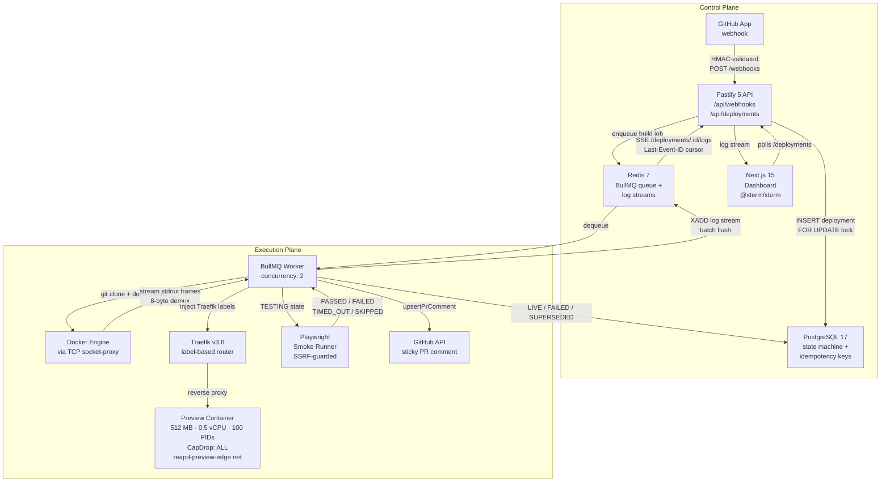

<div align="center">

# reapd

**Ephemeral preview environments, built from scratch.**

[](https://github.com/Sandesh282/reapd/actions/workflows/backend_unit_tests.yml)
[](https://github.com/Sandesh282/reapd/actions/workflows/full_stack_smoke_tests.yml)
[](https://github.com/Sandesh282/reapd/actions/workflows/all_lint_checks.yml)
[](https://github.com/Sandesh282/reapd/actions/workflows/all_type_checks.yml)


> A self-hosted preview environment engine. Containerised builds, 8-byte Docker stream demux,  
> Redis Streams → SSE log replay, SSRF-guarded Playwright smoke checks,  
> and zero-reload Traefik routing — wired together on a single Linux host.

</div>

---

## Why reapd?

Most preview-environment platforms are hosted SaaS with per-seat pricing, opaque build queues, and no insight into what happens inside the sandbox. reapd is a self-hosted alternative that exposes every layer: a GitHub App webhook hits a Fastify API, a BullMQ worker clones and builds the commit in an isolated Docker container, build logs stream over Redis Streams → Server-Sent Events to an `@xterm/xterm` terminal in the browser, and a Playwright smoke runner validates the preview before it goes `LIVE`. The whole lifecycle, from `git push` to sticky PR comment, runs on a single Linux host with no cloud dependencies.

---

## System Architecture



**Control Plane** handles ingestion, state, and streaming; hence no Docker socket exposure. **Execution Plane** does the dirty work inside locked containers on an isolated network bridge. The two planes share only Redis (queue + streams) and Postgres (state).

---

## Core Engineering Decisions

### 1 · The Docker log stream isn't just bytes

When you attach to a Docker container, you don't get raw stdout. The API multiplexes `stdout` and `stderr` into a single byte stream where every chunk is prefixed by an 8-byte header: 1 byte for stream type, 3 bytes of padding, 4 bytes for payload length. Split on `\n` directly and you'll corrupt lines that span frame boundaries or mash two lines that share one frame.

[`packages/docker-client/src/log-demux.ts`](packages/docker-client/src/log-demux.ts) handles this by buffering incoming chunks until a complete frame (8-byte header plus payload) is available. It reassembles frames first, then splits on newlines, tagging each line `stdout` or `stderr` before passing it upstream.

From there, the worker's log sink ([`apps/worker/src/logs/log-sink.ts`](apps/worker/src/logs/log-sink.ts)) batches lines into a Redis Stream (`XADD logs:build:<id> MAXLEN ~ 2000`) with an async background flush, so a 1,500-line burst from a noisy build step doesn't stall the event loop. Every flush also refreshes a 6h `EXPIRE` on the key, so streams from crashed workers don't accumulate forever.

On the read side, the SSE route ([`apps/api/src/routes/deployments.ts`](apps/api/src/routes/deployments.ts)) uses `XREAD COUNT 200 BLOCK 5000` with the browser's `Last-Event-ID` as the cursor, so a tab that reconnects mid-build picks up exactly where it left off. Two edge cases worth mentioning: the route rejects any entry where `source !== 'system'` to block forged `end:LIVE` markers injected via a malicious build step, and if the worker died before writing the end marker, the route falls back to Postgres on every `XREAD` timeout: once the deployment is terminal in the DB it does one short grace read for any final lines, then closes the SSE connection instead of hanging. On resume, `XINFO STREAM` is used for gap detection, so a client that reconnects after `MAXLEN` trimmed its cursor is told that entries were dropped.

### 2 · Routing without reloads

Every preview gets a subdomain (`pr-<n>.preview.localhost` locally, `pr-<n>.preview.reapd.sh` in production). The obvious approach is to write an nginx or Traefik config file and reload it. The problem is that config reloads drop in-flight connections, and at high throughput you're doing this for every push.

Instead, reapd stamps each container at `docker create` time with Traefik v3 labels:

```
traefik.enable=true
traefik.http.routers.pr-{n}.rule=Host(`pr-{n}.preview.localhost`)
traefik.http.routers.pr-{n}.entrypoints=websecure
traefik.http.routers.pr-{n}.tls=true
traefik.http.services.pr-{n}.loadbalancer.server.port={containerPort}
```

Traefik watches Docker through a TCP socket-proxy that blocks `EXEC`, `HOST`, `VOLUMES` and `PRIVILEGED` (`POST` is enabled because the worker also creates containers and builds images through it) and picks up the new route as soon as Docker emits the container-start event. When the container is reaped, the route disappears with it. No cleanup step, no stale config entry.

### 3 · Rapid pushes without zombie containers

Push three commits in five seconds and you get three webhooks, three BullMQ jobs, and three workers racing to build. Without coordination, all three finish and you end up with three `LIVE` containers for the same PR, two of which are orphaned.

The fix is a monotonic generation counter on the `pull_requests` row, combined with two layers of cancellation:

1. **Ingest.** The API handles every webhook in one transaction: it locks the PR row, increments `latest_generation`, and marks every older non-terminal deployment for that PR `SUPERSEDED`. A worker that dequeues a stale job later is caught by `transitionDeploymentStatus`, which rewrites any forward transition from an older generation to `SUPERSEDED`.
2. **Cancel signal.** After the transaction commits, the API publishes to `cancel:deploy:<id>` for each superseded deployment. Each worker subscribes to the channel for the job it is running and wires it to an `AbortSignal`, which stops the in-flight Docker build instead of letting it run to completion. No polling, no waiting for the next DB round-trip.

### 4 · Smoke testing without letting the page call home

Once a container passes its `STARTING` health check, the deployment moves to `TESTING` and a headless Playwright probe runs against the preview URL ([`apps/worker/src/smoke/smoke-runner.ts`](apps/worker/src/smoke/smoke-runner.ts)). Three things have to be true for it to pass:

| Criterion | Check |
|-----------|-------|
| HTTP status | `< 400` |
| Rendered content | `document.body.innerText.trim().length > 0` or a visual element (`img`, `canvas`, `svg`, `video`, `iframe`) is present. A blank SPA shell with nothing but `<div id="root"></div>` fails. |
| Zero errors | `console.error` count + uncaught `pageerror` count = 0 |

The tricky part is SSRF. The preview page runs arbitrary user code and can make fetch calls to `redis`, `postgres`, `169.254.169.254`, or any internal host the Docker network can reach. `context.route()` (not `page.route()`, which doesn't cover service workers) intercepts every outbound request and runs it through `isAllowedSmokeRequestUrl`. The only things that get through are the preview's own origin and public CDN assets. Everything else is aborted before it touches the network: private IP ranges, loopback, single-label hostnames, `.internal`/`.lan`, IPv4-mapped IPv6 like `::ffff:7f00:1`, trailing-dot variants.

If Chromium isn't installed, the probe returns `SKIPPED` via `SmokeUnavailableError` and the deployment still goes `LIVE`. It just skips the visual check. All error strings are run through `redactSecrets()` before truncation, so tokens or passwords that leak into `console.error` never reach `test_runs.failure_message` or the public API.

After the smoke result is committed, `upsertPrComment` ([`apps/worker/src/github/pr-comment.ts`](apps/worker/src/github/pr-comment.ts)) updates the sticky PR comment in-place: `POST` on first deploy, `PATCH` on every subsequent generation, `POST` again if the original was deleted with the orphaned duplicate cleaned up immediately. The comment ID lives in `pull_requests.sticky_comment_id` with an optimistic-lock check, so a concurrent supersede can't leave two comments on the same PR.

### 5 · A pure state machine, applied under row locks

The deployment lifecycle is a strict one-way graph. The edges live in one pure function ([`packages/types/src/domain/state-machine.ts`](packages/types/src/domain/state-machine.ts)), so every writer shares the same rules:

```
QUEUED → BUILDING → STARTING → TESTING → LIVE → EXPIRED

QUEUED, BUILDING, STARTING, TESTING → FAILED
QUEUED, BUILDING, STARTING, TESTING → SUPERSEDED
```

- `QUEUED`, `BUILDING`, `STARTING` and `TESTING` can each move forward one step, or go to `FAILED` or `SUPERSEDED`.
- `LIVE` can only go to `EXPIRED` (PR closed or TTL elapsed).
- `FAILED`, `SUPERSEDED` and `EXPIRED` are terminal and can never be overwritten.

Every transition goes through `transitionDeploymentStatus` ([`packages/db/src/repositories/deployments.ts`](packages/db/src/repositories/deployments.ts)), which runs in one transaction. It locks the parent `pull_requests` row, then the `deployments` row (`FOR UPDATE`, always in that order, so concurrent webhooks and workers can't deadlock). It then checks the edge with `assertValidTransition` and writes the new status plus an audit row in `deployment_events`. If the deployment is already terminal, because a push superseded it or the reconciler expired it, the call is a no-op and returns `transitioned: false` so the caller can clean up. An edge that isn't allowed throws `InvalidStateTransitionError`. The database provides the locking and atomicity; the rules themselves are in application code.

The `generation` column handles the race where a stale BullMQ job finally dequeues after a newer push has won. `pull_requests.latest_generation` is bumped on every webhook, and any transition from an older generation (other than to `SUPERSEDED`/`EXPIRED`) is rewritten to `SUPERSEDED` ("Preempted by generation N"), so a stale job can never take a deployment `LIVE`. The worker also tags images with the generation (`reapd-pr-104:g2-a1b2c3d`) and only removes images from older generations, so it never touches a newer one's container.

Webhook idempotency is a separate check. Each delivery's `X-GitHub-Delivery` ID is inserted into `webhook_deliveries` with `ON CONFLICT DO NOTHING` inside the same transaction as the rest of the ingest, so a re-delivered webhook returns early without queuing a duplicate job. (`pull_requests` is unique on `(repo_id, pr_number)`.)

---

## Sandbox Isolation & Security Model

| Control | Implementation | Value |
|---------|---------------|-------|
| Memory cap | `HostConfig.Memory` | 512 MB |
| Swap | `HostConfig.MemorySwap = Memory` | 0 B (no disk thrash) |
| CPU cap | `HostConfig.NanoCpus` | 0.5 vCPU |
| PID cap | `HostConfig.PidsLimit` | 100 (fork-bomb resistant) |
| Linux capabilities | `HostConfig.CapDrop` | `ALL` dropped |
| Network | `HostConfig.NetworkMode` | `reapd-preview-edge` isolated bridge (ICC disabled deferred to Phase 7) |
| Docker socket | TCP socket-proxy | Restricted: `EXEC`, `HOST`, `VOLUMES` blocked; `POST` enabled for container lifecycle ops |
| Webhook auth | HMAC-SHA256 | `X-Hub-Signature-256` verified before any DB write |
| Smoke browser | `serviceWorkers: 'block'` + `context.route` SSRF guard | Blocks private IPs, single-label hosts, loopback, non-preview origins |
| Secret leakage | `redactSecrets()` | Applied before every log truncation, failure message write, and SSE emit |
| PR comment injection | Dynamic fence + `@`-neutralisation | User-controlled branch name cannot break the markdown fence or ping users |

> **Phase 7 adds:** gVisor `runsc` runtime (syscall interception), Cloudflare DNS-01 wildcard ACME (`*.reapd.sh`), and containerised Playwright in its own network namespace.

---

## CI / Verification

**29 checks** across 6 workflows on every PR:

| Workflow | Jobs |
|----------|------|
| Backend unit tests | Verify test files exist · `@reapd/docker-client` · `@reapd/worker` · `@reapd/api` · PostgreSQL 17 integration |
| Full-stack smoke tests | Phase 1 (Hardened Container & Traefik TLS) · Phase 2 (CLI Clone & BuildKit) · Phase 3 (Webhook HMAC & Idempotency) · Phase 4 (Rapid Superseding & Reconciler) · Phase 5 (REST API & SSE Log Streaming) · Phase 6 (Playwright Smoke Runner & Sticky PR Comment) |
| All lint checks | ShellCheck on the smoke scripts · 4-layer architecture and import boundaries · bad-pattern check (`@ts-ignore`, `.only(`, committed secrets) · lockfile and Node engine consistency · Docker socket-proxy hardening and loopback-only ports |
| All type checks | `tsc --noEmit` across all workspaces |
| PR hygiene (two workflows) | Branch name validation · PR description template check |

Each smoke gate is a self-contained `bash` script in [`infra/scripts/`](infra/scripts/) that spins up the full Docker Compose stack, exercises the real code path end-to-end, and tears everything down. The Phase 6 gate runs the GitHub App mock server, fires a webhook, streams SSE, and asserts the sticky PR comment was posted.

---

## Repository Structure

```
reapd/
├── apps/
│   ├── api/          # Fastify 5 REST + SSE + webhook ingestion
│   ├── worker/       # BullMQ build worker, smoke runner, reconciler
│   └── web/           # Next.js 15 App Router + @xterm/xterm terminal
├── packages/
│   ├── db/           # Drizzle ORM, PostgreSQL schema, migrations, repositories
│   ├── docker-client/# Docker Engine API client, 8-byte log demux, AbortError
│   └── types/        # Shared TypeScript types (DeploymentStatus, TestRunStatus…)
├── infra/
│   ├── docker-compose.yml      # Infra services: Traefik, Redis, Postgres, socket-proxy, Prometheus, Grafana (API/worker/web run separately)
│   └── scripts/
│       ├── cli-smoke.sh        # Phase 1: container isolation + Traefik TLS
│       ├── phase2-smoke.sh     # Phase 2: git clone + BuildKit image build
│       ├── phase3-smoke.sh     # Phase 3: webhook HMAC + idempotency
│       ├── phase4-smoke.sh     # Phase 4: rapid superseding + reconciler
│       ├── phase5-smoke.sh     # Phase 5: REST API + SSE log streaming
│       └── phase6-smoke.sh     # Phase 6: Playwright smoke + sticky PR comment
├── sample-app/       # Minimal Node.js HTTP server used as the build target in smoke tests
└── turbo.json        # Turborepo pipeline (build → test → lint → typecheck)
```

---

## Quick Start (Self-Hosting Through Phase 6)

### Prerequisites

- Docker Engine 24+ with BuildKit enabled
- Node.js 22+ and npm 10+
- A GitHub App (for webhook delivery and PR comments) — or use the Phase 6 mock server for local testing without one

### 1. Clone and install

```bash
git clone https://github.com/Sandesh282/reapd.git
cd reapd
npm install
```

### 2. Configure environment

```bash
cp .env.example .env
```

Key variables:

| Variable | Description |
|----------|-------------|
| `DATABASE_URL` | PostgreSQL connection string |
| `REDIS_URL` | Redis connection string |
| `GITHUB_APP_ID` | GitHub App ID (Phase 6+) |
| `GITHUB_APP_PRIVATE_KEY` | PEM private key for JWT signing |
| `GITHUB_WEBHOOK_SECRET` | HMAC secret for webhook verification |
| `REAPD_DASHBOARD_PUBLIC_URL` | Public URL of the dashboard (embedded in PR comments) |
| `REAPD_SMOKE_REQUIRED` | `true` to fail deployments when smoke check is `SKIPPED` |
| `REAPD_CHROMIUM_NO_SANDBOX` | `1` to pass `--no-sandbox` when running as root (CI) |

### 3. Start the infrastructure

```bash
docker compose --env-file .env -f infra/docker-compose.yml up -d
# starts: Traefik, Redis, PostgreSQL, socket-proxy, Prometheus, Grafana
```

Then run the application processes in separate terminals:

```bash
npm run build                        # Turborepo builds all packages in dependency order
npm run dev --workspace apps/api     # Fastify API on :3001
npm run dev --workspace apps/worker  # BullMQ worker
npm run dev --workspace apps/web     # Next.js dashboard on :3000
```

### 4. Run the smoke gates (no GitHub App required for Phases 1–5)

```bash
# Each script is self-contained: starts stack, runs assertions, tears down
bash infra/scripts/cli-smoke.sh       # Phase 1 — container isolation
bash infra/scripts/phase2-smoke.sh    # Phase 2 — git clone + build
bash infra/scripts/phase3-smoke.sh    # Phase 3 — webhook HMAC
bash infra/scripts/phase4-smoke.sh    # Phase 4 — superseding + reconciler
bash infra/scripts/phase5-smoke.sh    # Phase 5 — SSE log streaming
bash infra/scripts/phase6-smoke.sh    # Phase 6 — Playwright smoke + PR comment
```

> Phase 6 requires `npx --no-install playwright-core install chromium` (uses the locked `playwright-core` revision, not the latest unpinned `playwright` package).

---

## Observability

The API and worker each expose Prometheus metrics (`prom-client`). `docker compose` also starts Prometheus (`:9090`) and Grafana (`:3030`, login `admin` / `$GRAFANA_ADMIN_PASSWORD`, default `admin`, loopback only) with a provisioned datasource and dashboard.

| Metric | Type | Source |
|--------|------|--------|
| `reapd_deployments_by_status{status}` | gauge | worker, PostgreSQL `GROUP BY status` every 15s (includes API-side `SUPERSEDED` and reconciler `EXPIRED`) |
| `reapd_deployments_total{status}` | counter | API (`SUPERSEDED`, PR-close `EXPIRED`) + worker (`LIVE`, `FAILED`) + reconciler (`EXPIRED`, `FAILED`), merged via `sum by (status)` |
| `reapd_build_duration_seconds{result}` | histogram | worker, BuildKit image build (`succeeded`, `failed`, `aborted`) |
| `reapd_queue_waiting`, `reapd_queue_active` | gauge | worker, BullMQ job counts every 15s |
| `reapd_active_previews` | gauge | worker, `LIVE` deployment count every 15s |
| `reapd_metrics_poll_last_success_timestamp_seconds` | gauge | worker, Unix timestamp of last successful Redis + DB metrics poll |
| `reapd_smoke_results_total{result}` | counter | worker, Playwright outcomes |
| `reapd_reconciler_sweep_duration_seconds` | histogram | reconciler sweep latency |
| `reapd_reconciler_last_success_timestamp_seconds` | gauge | reconciler, Unix timestamp of last successful sweep |
| `reapd_reconciler_expired_total`, `reapd_reconciler_fenced_total` | counter | reconciler TTL expirations and stuck-build fencing |
| `reapd_reconciler_orphans_removed_total{kind}` | counter | reconciler orphan `container` / `image` cleanup |
| `reapd_webhook_requests_total{event,action}` | counter | API, counted after HMAC verification |
| `reapd_webhook_rejections_total{reason}` | counter | API, rejected/deduplicated deliveries (`invalid_signature`, `fork_rejected`, `duplicate`, etc.) |

Endpoints: API at `http://127.0.0.1:3001/metrics` (with best-effort rejection of common reverse-proxy/tunnel headers like `X-Forwarded-*`, `Forwarded`, `X-Real-IP`, `CF-Connecting-IP`), worker at `http://127.0.0.1:9091/metrics` (override with `REAPD_WORKER_METRICS_HOST` / `REAPD_WORKER_METRICS_PORT`). Both bind to `127.0.0.1` by default — on Docker Desktop (`macOS`/`Windows`), `host.docker.internal` reaches host loopback directly; on Linux, where `host-gateway` resolves to the Docker bridge IP, set `REAPD_WORKER_METRICS_HOST` and `REAPD_API_HOST` to the bridge IP or run Prometheus with host networking.

---

## Upcoming Phases

### Phase 7 — Production Hardening

- **gVisor `runsc` runtime** — syscall interception at the kernel boundary; containers cannot escape via syscall fuzzing even with `CapDrop: ALL` bypasses
- **Cloudflare DNS-01 wildcard TLS** — Traefik ACME with `*.reapd.sh` wildcard cert; no per-subdomain cert issuance delay
- **Containerised Playwright smoke browser** — smoke runner runs inside its own network namespace so the Chromium process itself cannot reach the Docker host network
- **R2 cold log archival** — `log_archive_key` column is already in the schema; Phase 7 populates it when a deployment expires, moving the Redis Stream to Cloudflare R2 for long-term storage

### Phase 8 — Observability & Benchmarks

Prometheus metrics and a provisioned Grafana dashboard are already in (see [Observability](#observability)). Still to come:

- **k6 load tests** — 10-commit rapid-push superseding stress test, webhook ingestion p95, SSE reconnect under load
- **OpenTelemetry traces** — per-deployment span from webhook receipt to `LIVE`