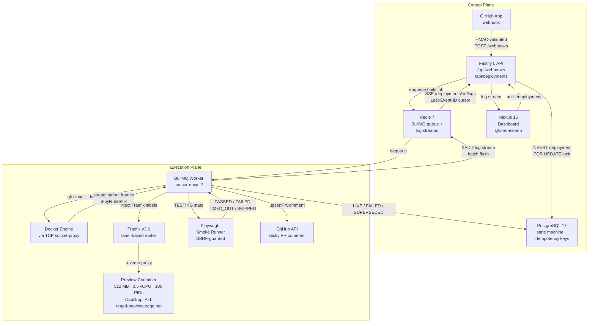

<div align="center">

# reapd

**Ephemeral preview environments, built from scratch.**

[](https://github.com/Sandesh282/reapd/actions/workflows/backend_unit_tests.yml)
[](https://github.com/Sandesh282/reapd/actions/workflows/full_stack_smoke_tests.yml)
[](https://github.com/Sandesh282/reapd/actions/workflows/all_lint_checks.yml)
[](https://github.com/Sandesh282/reapd/actions/workflows/all_type_checks.yml)


> Push a commit → watch it build, test, and go live in a sandboxed container —  
> all piped to your terminal in real time, with a sticky GitHub PR comment linking the preview.

</div>

---

## Why reapd?

Most preview-environment platforms are hosted SaaS with per-seat pricing, opaque build queues, and no insight into what happens inside the sandbox. reapd is a self-hosted alternative that exposes every layer: a GitHub App webhook hits a Fastify API, a BullMQ worker clones and builds the commit in an isolated Docker container, build logs stream over Redis Streams → Server-Sent Events to an `@xterm/xterm` terminal in the browser, and a Playwright smoke runner validates the preview before it goes `LIVE`. The whole lifecycle — from `git push` to sticky PR comment — runs on a single Linux host with no cloud dependencies.

---

## System Architecture



**Control Plane** handles ingestion, state, and streaming — no Docker socket exposure. **Execution Plane** does the dirty work inside locked containers on an isolated network bridge. The two planes share only Redis (queue + streams) and Postgres (state).

---

## Core Engineering Decisions

### 1 · 8-Byte Docker Stream Demultiplexing → Redis Streams → SSE

Docker's `container/attach` and `logs` endpoints multiplex `stdout` and `stderr` into a single byte stream using an 8-byte frame header: `[stream_type (1), padding (3), payload_length (4)]`. Naive line-reading breaks on this because a single `\n`-terminated line can be split across two frames, or two lines can share one frame.

[`packages/docker-client/src/log-demux.ts`](packages/docker-client/src/log-demux.ts) maintains a carry buffer and a state machine (`HEADER` → `PAYLOAD`) that reassembles frames before splitting on `\n`. Each reassembled line is tagged `stdout` or `stderr` and handed to the worker's log sink.

The sink ([`apps/worker/src/logs/log-sink.ts`](apps/worker/src/logs/log-sink.ts)) batches lines into a Redis Stream (`XADD build-log:<id> MAXLEN ~ 2000`) with a background async flush so a synchronous 1,500-line build burst never blocks the event loop. Every flush also runs `EXPIRE 6h` on the stream key so orphaned streams self-clean.

The API's SSE route ([`apps/api/src/routes/deployments.ts`](apps/api/src/routes/deployments.ts)) reads from the stream using `XREAD COUNT 100 BLOCK 2000 STREAMS build-log:<id> <cursor>` and respects the browser's `Last-Event-ID` header, so a tab that reconnects mid-build replays from its last confirmed entry — no lines dropped. A forged-line guard (`source === 'system'` check) ensures clients cannot inject fake `end:LIVE` markers. If the worker died before writing the end marker, the route falls back to `XINFO STREAM` to detect a stalled stream and closes the SSE cleanly.

### 2 · Zero-Reload Wildcard Routing via Traefik v3 Label Injection

Each preview container gets a unique subdomain (`pr-<number>.preview.localhost` locally, `pr-<number>.preview.reapd.sh` in production). Instead of reloading a config file, reapd sets Traefik v3 container labels at `docker create` time:

```
traefik.enable=true
traefik.http.routers.pr-{n}.rule=Host(`pr-{n}.preview.localhost`)
traefik.http.routers.pr-{n}.entrypoints=websecure
traefik.http.services.pr-{n}.loadbalancer.server.port={containerPort}
```

Traefik watches the Docker socket via a socket-proxy (read-only, no `exec`, no `post`) and picks up the new container within ~50 ms without a process restart or config reload. When the container is reaped, Traefik drops the route automatically because the labels disappear with the container.

### 3 · Generation Fencing + Rapid-Push Superseding

When a developer pushes three commits in five seconds, three webhooks arrive concurrently. Without coordination, all three would race to become `LIVE` and leave two zombie containers running.

reapd solves this with a **monotonic generation counter** per pull request and a two-layer lock:

1. **Database lock** — `SELECT … FOR UPDATE` on the `pull_requests` row, then increment `latest_generation`. Any worker whose `generation < latest_generation` at transition time calls `transitionDeploymentStatus('SUPERSEDED')` and exits.
2. **Redis pub/sub abort** — The worker that wins the lock publishes to `cancel:deploy:<id>`. Losing workers subscribe to this channel and receive an `AbortSignal` abort within < 1 s, stopping the Docker build mid-flight without polling.

The combination means a superseded build stops within a second of the newer push arriving, not at the next DB poll interval.

### 4 · Playwright Smoke Runner + SSRF Guard + Sticky PR Comment

After a container passes the `STARTING` health-check, the worker enters the `TESTING` state and runs a headless Playwright probe ([`apps/worker/src/smoke/smoke-runner.ts`](apps/worker/src/smoke/smoke-runner.ts)). Three criteria must all pass:

| Criterion | Check |
|-----------|-------|
| HTTP status | `< 400` |
| Rendered content | `document.body.innerText.trim().length > 0` **or** a visual element (`img`, `canvas`, `svg`, `video`, `iframe`) is present — catches blank SPA shells |
| Zero errors | `console.error` count + uncaught `pageerror` count = 0 |

**SSRF guard** — `context.route()` (not `page.route()`, which misses service workers) intercepts every outbound request the preview page makes. `isAllowedSmokeRequestUrl` permits only the preview's exact origin (`scheme + host + port`) and public CDN assets, and aborts:
- Any `localhost` / `*.localhost` origin other than the preview's own
- Single-label hostnames (e.g. `redis`, `postgres`)
- `.internal` / `.lan` suffixes
- Loopback IPs: `127.x.x.x`, `::1`, IPv4-mapped IPv6 `::ffff:7f00:0/112`
- Trailing-dot variants (stripped before every check: `localhost.` → `localhost`)
- Non-standard ports on the preview hostname

If Chromium is not installed, the probe returns `SKIPPED` (via `SmokeUnavailableError`) — this does **not** fail the deployment, so the worker gracefully degrades on hosts without a browser binary.

All error messages are **redacted before truncation** (`redactSecrets()` runs before `slice(0, 200)`) so GitHub tokens or Basic auth credentials in a page's console output can never reach `test_runs.failure_message` or the unauthenticated API.

**Sticky PR comment** — `upsertPrComment` ([`apps/worker/src/github/pr-comment.ts`](apps/worker/src/github/pr-comment.ts)) follows a `POST → PATCH → 404-fallback → orphan-DELETE` strategy. It stores the GitHub comment ID in `pull_requests.sticky_comment_id` with an optimistic-lock check (`setStickyCommentId` returns `false` if superseded while posting, then deletes the orphaned new comment). The comment is updated — never duplicated — across every generation of the same PR.

### 5 · Deployment State Machine + Idempotent Webhook Ingestion

Every deployment follows a strict one-way state machine enforced at the database level:

```
QUEUED → BUILDING → STARTING → TESTING → LIVE
                                        ↘ FAILED
                              ↘ SUPERSEDED (any state)
LIVE → EXPIRED  (TTL-elapsed, via reconciler)
```

Valid transitions are enforced by `transitionDeploymentStatus`, which does a `UPDATE … WHERE status = $expected RETURNING *` — if the row has already moved on (e.g. SUPERSEDED by a concurrent push), the update matches zero rows and the function throws, preventing double-transitions.

Webhook idempotency is handled by `(repo_id, pr_number, head_sha)` uniqueness: a re-delivered `push` event for the same SHA upserts the existing deployment row rather than creating a duplicate job. A `generation` column ensures the BullMQ job for the stale generation self-terminates if a newer one has already claimed the lock.

---

## Sandbox Isolation & Security Model

| Control | Implementation | Value |
|---------|---------------|-------|
| Memory cap | `HostConfig.Memory` | 512 MB |
| Swap | `HostConfig.MemorySwap = Memory` | 0 B (no disk thrash) |
| CPU cap | `HostConfig.NanoCpus` | 0.5 vCPU |
| PID cap | `HostConfig.PidsLimit` | 100 (fork-bomb resistant) |
| Linux capabilities | `HostConfig.CapDrop` | `ALL` dropped |
| Network | `HostConfig.NetworkMode` | `reapd-preview-edge` (isolated bridge; ICC disabled) |
| Docker socket | TCP socket-proxy | Read-only; no `exec`, `post`, `delete` passthrough to host |
| Webhook auth | HMAC-SHA256 | `X-Hub-Signature-256` verified before any DB write |
| Smoke browser | `serviceWorkers: 'block'` + `context.route` SSRF guard | Blocks private IPs, single-label hosts, loopback, non-preview origins |
| Secret leakage | `redactSecrets()` | Applied before every log truncation, failure message write, and SSE emit |
| PR comment injection | Dynamic fence + `@`-neutralisation | User-controlled branch name cannot break the markdown fence or ping users |

> **Phase 7 adds:** gVisor `runsc` runtime (syscall interception), Cloudflare DNS-01 wildcard ACME (`*.reapd.sh`), and containerised Playwright in its own network namespace.

---

## CI / Verification

**28 checks** across 5 workflows on every PR:

| Workflow | Jobs |
|----------|------|
| Backend unit tests | Verify test files exist · `@reapd/docker-client` · `@reapd/worker` · `@reapd/api` · PostgreSQL 17 integration |
| Full-stack smoke tests | Phase 1 (Hardened Container & Traefik TLS) · Phase 2 (CLI Clone & BuildKit) · Phase 3 (Webhook HMAC & Idempotency) · Phase 4 (Rapid Superseding & Reconciler) · Phase 5 (REST API & SSE Log Streaming) · Phase 6 (Playwright Smoke Runner & Sticky PR Comment) |
| All lint checks | ESLint across all workspaces |
| All type checks | `tsc --noEmit` across all workspaces |
| PR hygiene | Branch name validation · PR description template check |

Each smoke gate is a self-contained `bash` script in [`infra/scripts/`](infra/scripts/) that spins up the full Docker Compose stack, exercises the real code path end-to-end, and tears everything down. The Phase 6 gate runs the GitHub App mock server, fires a webhook, streams SSE, and asserts the sticky PR comment was posted.

---

## Repository Structure

```
reapd/
├── apps/
│   ├── api/          # Fastify 5 REST + SSE + webhook ingestion
│   ├── worker/       # BullMQ build worker, smoke runner, reconciler
│   └── dashboard/    # Next.js 15 App Router + @xterm/xterm terminal
├── packages/
│   ├── db/           # Drizzle ORM, PostgreSQL schema, migrations, repositories
│   ├── docker-client/# Docker Engine API client, 8-byte log demux, AbortError
│   └── types/        # Shared TypeScript types (DeploymentStatus, TestRunStatus…)
├── infra/
│   ├── docker-compose.yml      # Full stack: API, worker, dashboard, Traefik, Redis, Postgres, socket-proxy
│   └── scripts/
│       ├── cli-smoke.sh        # Phase 1: container isolation + Traefik TLS
│       ├── phase2-smoke.sh     # Phase 2: git clone + BuildKit image build
│       ├── phase3-smoke.sh     # Phase 3: webhook HMAC + idempotency
│       ├── phase4-smoke.sh     # Phase 4: rapid superseding + reconciler
│       ├── phase5-smoke.sh     # Phase 5: REST API + SSE log streaming
│       └── phase6-smoke.sh     # Phase 6: Playwright smoke + sticky PR comment
├── sample-app/       # Minimal Node.js HTTP server used as the build target in smoke tests
└── turbo.json        # Turborepo pipeline (build → test → lint → typecheck)
```

---

## Quick Start (Self-Hosting Through Phase 6)

### Prerequisites

- Docker Engine 24+ with BuildKit enabled
- Node.js 22+ and npm 10+
- A GitHub App (for webhook delivery and PR comments) — or use the Phase 6 mock server for local testing without one

### 1. Clone and install

```bash
git clone https://github.com/Sandesh282/reapd.git
cd reapd
npm install
```

### 2. Configure environment

```bash
cp .env.example .env
```

Key variables:

| Variable | Description |
|----------|-------------|
| `DATABASE_URL` | PostgreSQL connection string |
| `REDIS_URL` | Redis connection string |
| `GITHUB_APP_ID` | GitHub App ID (Phase 6+) |
| `GITHUB_APP_PRIVATE_KEY` | PEM private key for JWT signing |
| `GITHUB_WEBHOOK_SECRET` | HMAC secret for webhook verification |
| `REAPD_DASHBOARD_PUBLIC_URL` | Public URL of the dashboard (embedded in PR comments) |
| `REAPD_SMOKE_REQUIRED` | `true` to fail deployments when smoke check is `SKIPPED` |
| `REAPD_CHROMIUM_NO_SANDBOX` | `1` to pass `--no-sandbox` when running as root (CI) |

### 3. Start the full stack

```bash
docker compose -f infra/docker-compose.yml up -d
npm run build   # Turborepo builds all packages in dependency order
```

### 4. Run the smoke gates (no GitHub App required for Phases 1–5)

```bash
# Each script is self-contained: starts stack, runs assertions, tears down
bash infra/scripts/cli-smoke.sh       # Phase 1 — container isolation
bash infra/scripts/phase2-smoke.sh    # Phase 2 — git clone + build
bash infra/scripts/phase3-smoke.sh    # Phase 3 — webhook HMAC
bash infra/scripts/phase4-smoke.sh    # Phase 4 — superseding + reconciler
bash infra/scripts/phase5-smoke.sh    # Phase 5 — SSE log streaming
bash infra/scripts/phase6-smoke.sh    # Phase 6 — Playwright smoke + PR comment
```

> Phase 6 requires `npx --no-install playwright-core install chromium` (uses the locked `playwright-core` revision, not the latest unpinned `playwright` package).

---

## Upcoming Phases

### Phase 7 — Production Hardening

- **gVisor `runsc` runtime** — syscall interception at the kernel boundary; containers cannot escape via syscall fuzzing even with `CapDrop: ALL` bypasses
- **Cloudflare DNS-01 wildcard TLS** — Traefik ACME with `*.reapd.sh` wildcard cert; no per-subdomain cert issuance delay
- **Containerised Playwright smoke browser** — smoke runner runs inside its own network namespace so the Chromium process itself cannot reach the Docker host network
- **R2 cold log archival** — `log_archive_key` column is already in the schema; Phase 7 populates it when a deployment expires, moving the Redis Stream to Cloudflare R2 for long-term storage

### Phase 8 — Observability & Benchmarks

- **k6 load tests** — 10-commit rapid-push superseding stress test, webhook ingestion p95, SSE reconnect under load
- **OpenTelemetry traces** — per-deployment span from webhook receipt to `LIVE`, exported to a self-hosted Tempo instance
- **Grafana dashboard** — build queue depth, reconciler sweep latency, active preview count


